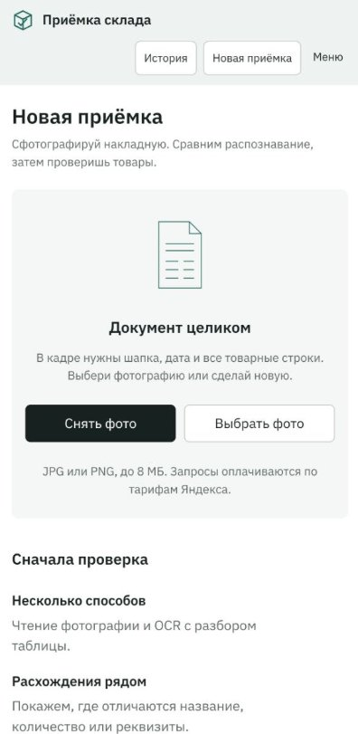
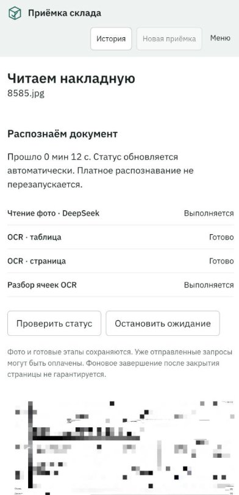
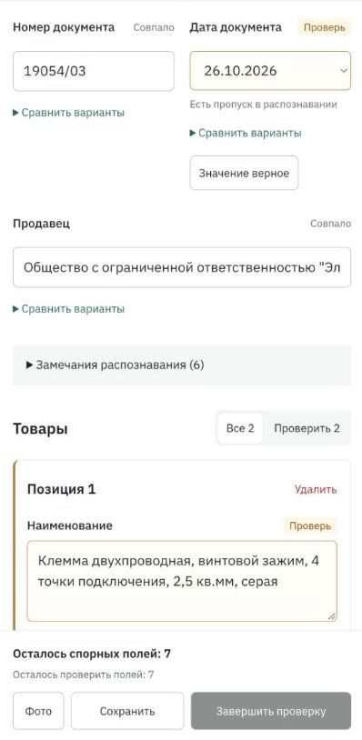
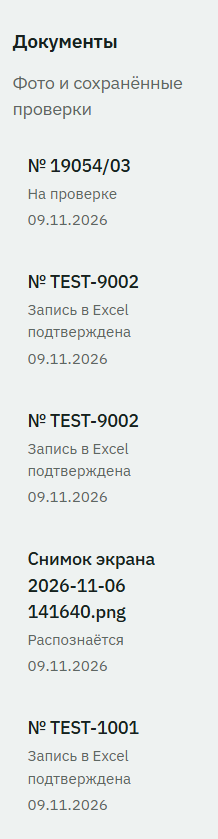
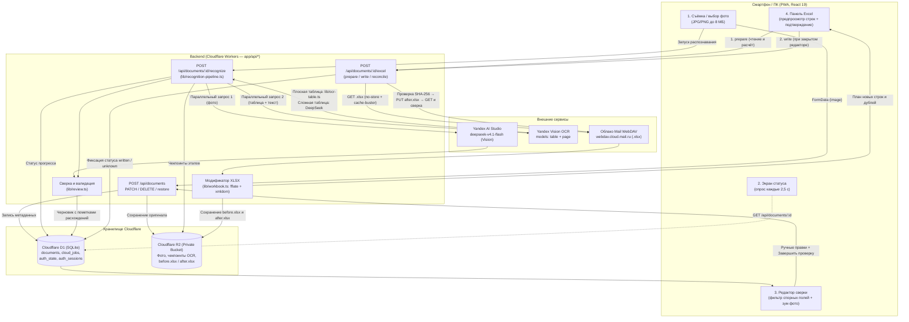

# Warehouse Intake Automation — Приёмка склада


Веб-приложение (PWA) для автоматизации складской приёмки по фотографиям товарных накладных и УПД. Приложение разработано и внедрено для реальной ежедневной работы на складе: кладовщик фотографирует бумажный документ со смартфона, система параллельно распознаёт позиции двумя независимыми алгоритмами ИИ/OCR, выделяет спорные места для быстрой ручной сверки и автоматически дописывает проверенные строки напрямую в рабочую книгу Excel (`.xlsx`) в Облаке Mail по протоколу WebDAV с сохранением форматирования.

---

## Содержание

1. [Проблема, которую решает приложение](#проблема-которую-решает-приложение)
2. [Решение и пользовательский сценарий](#решение-и-пользовательский-сценарий)
3. [Эффективность автоматизации](#эффективность-автоматизации)
4. [Демонстрация работы](#демонстрация-работы)
5. [Технологический стек](#технологический-стек)
6. [Архитектура приложения](#архитектура-приложения)
7. [Установка и запуск](#установка-и-запуск)
8. [Подключение собственной таблицы Mail](#подключение-собственной-таблицы-mail)
9. [Конфигурация и безопасность](#конфигурация-и-безопасность)
10. [Ограничения и дальнейшее развитие](#ограничения-и-дальнейшее-развитие)
11. [Автор](#автор)

---

## Проблема, которую решает приложение

При работе на складе учёт поступающих товаров ведётся в электронной таблице Excel в Облаке Mail. До внедрения приложения каждую бумажную товарную накладную или универсальный передаточный документ (УПД) приходилось переносить в таблицу вручную:

- Для каждой позиции необходимо было без ошибок перепечатать полное наименование со сложной маркировкой, размерностью и артикулом, указать количество, единицу измерения, номер документа, поставщика и дату поступления.
- В пиковые дни на склад приходит **5–6 машин**, а общий объём приёмки составляет **100–120 товарных позиций в день**.
- Ручной ввод и сверка одной позиции занимали в среднем **около 2 минут**, что выливалось в **200–240 минут (3,5–4 часа)** монотонной работы за смену — не считая времени на поиск и исправление опечаток.
- Высокий риск человеческого фактора: легко перепутать похожие символы в длинном артикуле, ошибиться в количестве или случайно записать число штук в упаковке из названия товара вместо фактического количества принятых упаковок.

---

## Решение и пользовательский сценарий

Вместо слепого доверия одной нейросети в проекте реализован конвейер **перекрёстной сверки двух независимых каналов распознавания** с обязательным контролем человеком (**Human-in-the-Loop**) перед записью в учётную таблицу:

1. **Открытие на смартфоне:** Кладовщик открывает установленное на главный экран телефона PWA-приложение и проходит авторизацию по собственному защищённому коду доступа.
2. **Фотографирование документа:** Пользователь снимает накладную или УПД на камеру телефона (или выбирает готовое фото JPG/PNG до 8 МБ).
3. **Параллельное распознавание ИИ и OCR:**
   - **Канал 1 (VLM):** Мультимодальная модель `deepseek-v4.1-flash` читает непосредственно изображение документа.
   - **Канал 2 (OCR + парсинг):** Yandex Vision OCR (`table` и `page`) извлекает табличную разметку и текст. Если таблица имеет однозначные плоские колонки, детерминированный парсер (`lib/ocr-table.ts`) извлекает ячейки напрямую без второго вызова LLM; для сложных и многоуровневых шапок подключается структурирование через `deepseek-v4.1-flash`.
   - Оба канала работают параллельно. Промежуточные результаты каждого этапа сохраняются в хранилище, а экран в реальном времени (каждые 2,5 с) показывает прогресс. Если один из способов завершился раньше, результат можно открыть сразу, не дожидаясь второго.
4. **Автоматическое сопоставление и выявление расхождений (`lib/review.ts`):** Система попарно сверяет номер, дату, поставщика и каждую товарную строку из двух источников. Если оба метода дали одинаковый результат, поле помечается как «Совпало». Если значения отличаются, один из методов пропустил поле или OCR объединил соседние ячейки — поле подсвечивается статусом **«Проверь»** с показом обоих вариантов.
5. **Проверка и корректировка человеком:** Пользователь просматривает позиции прямо с телефона (доступен фильтр «Проверить», показывающий только спорные строки, и зум оригинала фотографии в один тап), выбирает верный вариант одной кнопкой или правит текст вручную, после чего нажимает **«Завершить проверку»**.
6. **Подготовка записи и защита от дублей (`lib/workbook.ts`):** При нажатии **«Подготовить запись»** сервер скачивает актуальную книгу `.xlsx` из Облака Mail по WebDAV, проверяет структуру таблицы, вычисляет уже внесённые позиции (чтобы повторная загрузка документа или дозагрузка второй страницы не создавали дублей) и формирует предпросмотр новых строк.
7. **Автоматическая запись в таблицу Mail (`lib/cloud-mail.ts`):** Пользователь подтверждает, что онлайн-редактор закрыт, и нажимает кнопку записи. Сервер сохраняет резервную копию книги до изменений в R2, точечно модифицирует XML внутри `.xlsx` (сохраняя стили, выравнивание по центру, форматы дат, автофильтры и остальные листы), выгружает обновлённый файл по WebDAV и верифицирует результат повторным чтением с проверкой SHA-256 и побайтовым сравнением всех внутренних частей архива.

> [!IMPORTANT]
> **Контроль качества человеком (Human-in-the-Loop):** Приложение технически блокирует кнопку «Завершить проверку» и переход к выгрузке в Excel до тех пор, пока пользователь явно не подтвердит или не отредактирует все спорные поля, не заполнит обязательные реквизиты и корректную календарную дату.

---

## Эффективность автоматизации

Ниже приведено сравнение трудозатрат при обработке пикового дневного объёма поставок (5–6 машин, 100–120 товарных позиций).

| Показатель | До внедрения (ручной ввод) | После внедрения (AI + проверка) | Изменение |
| :--- | :--- | :--- | :--- |
| **Способ переноса данных** | Ручная перепечатка каждой строки с бумаги в Excel | Фото на телефон → сверка подсвеченных полей → автозапись | Полный отказ от ручного набора |
| **Время на 1 позицию** | ~2 минуты | Секунды (визуальная проверка готового черновика) | Кратное ускорение |
| **Время на 100–120 позиций (пиковый день)** | **200–240 минут** (3,5–4 часа) | **~10–15 минут** на все поставки за день | **Экономия > 90% времени** |
| **Форматирование таблицы** | Ручное выравнивание ячеек и протягивание диапазона | Автоматическое копирование стиля строки, дат и фильтра `A1:G...` | Без ручной правки верстки |
| **Повторная загрузка накладной** | Риск продублировать приход при невнимательности | Автоматический пропуск точных совпадений (`skipped`) | Защита от дублей |

> [!NOTE]
> Указанные показатели времени (10–15 минут в день и экономия более 90%) являются **расчётной оценкой на основе реального рабочего сценария** приёмки 100–120 позиций, а не результатом длительного статистического замера.

---

## Демонстрация работы

Интерфейс спроектирован по принципу Mobile-First для работы одной рукой на складе, а на настольном ПК автоматически перестраивается в двухколоночный режим (редактор слева, исходная фотография справа).

| 1. Главный экран (Новая приёмка) | 2. Прогресс распознавания ИИ и OCR |
| :---: | :---: |
|  |  |
| *Выбор или съёмка фото накладной со смартфона* | *Независимое выполнение чтения фото DeepSeek и Yandex Vision OCR с таймером и чекпоинтами* |

| 3. Проверка, сравнение вариантов и подтверждение | 4. История документов и статусы |
| :---: | :---: |
|  |  |
| *Подсветка спорных полей («Проверь»), сравнение вариантов распознавания и фильтр позиций* | *Список загруженных накладных с текущими статусами проверки и подтверждения записи в Excel* |

### Дополнительные скриншоты, которые можно добавить в `docs/screenshots/`

Папка `docs/screenshots/` уже создана и содержит 4 реальных скриншота выше. Для полной демонстрации финального шага записи в облако рекомендуется при желании доснять на тестовых данных ещё два материала:

- `docs/screenshots/05-excel-preview.jpg` — блок «Запись в Excel» с таблицей предпросмотра новых строк (`Будет добавлено: N`), чекбоксом закрытия редактора и ссылкой на скачивание резервной копии.
- `docs/screenshots/06-mail-excel-result.png` — вид таблицы `.xlsx` в Облаке Mail с автоматически добавленными и выровненными по центру строками.
- *(Опционально)* `docs/screenshots/demo-workflow.gif` — короткая GIF-анимация (10–15 секунд) сквозного процесса от выбора фото до подтверждения позиций.

> [!CAUTION]
> **Требование безопасности для скриншотов:** При добавлении новых изображений используйте только синтетические/тестовые накладные (например, `TEST-1001`, `TEST-9002`) и тестовую книгу `/Sklad_test.xlsx`. Не публикуйте на скриншотах реальные персональные данные, коммерческие цены, закрытые реквизиты контрагентов, пароли или токены.

---

## Технологический стек

Стек определён строго по `package.json` и серверным модулям проекта (`phone-app/`):

- **Frontend:**
  - **React 19** (`19.2.6`) + **TypeScript 5.9**
  - **Vinext** (`1.0.0-beta.5`) / **Next.js App Router API** (`16.3.4`) + **Vite 8** (`8.0.13`)
  - Адаптивный CSS (`app/globals.css`) с поддержкой PWA (`manifest.webmanifest`, Service Worker `public/sw.js`) и нативного `<dialog>` для зума фотографий.
- **Backend и среда выполнения:**
  - **Cloudflare Workers** (`@cloudflare/vite-plugin`, `wrangler 4.92`, `nodejs_compat`) — серверные API-маршруты в `app/api/*`.
- **AI / OCR:**
  - **Yandex Cloud AI Studio** (`/v1/chat/completions`) — модель `deepseek-v4.1-flash` для прямого мультимодального чтения фотографии и структурирования сложных таблиц OCR.
  - **Yandex Vision OCR** (`/ocr/v1/recognizeText`) — модели `table` (распознавание сетки таблиц) и `page` (полнотекстовое чтение страницы).
  - Детерминированный парсер плоских таблиц OCR (`lib/ocr-table.ts`).
- **Интеграции и работа с Excel:**
  - **Облако Mail WebDAV** (`https://webdav.cloud.mail.ru`) — чтение и перезапись книги `.xlsx` по протоколу HTTP Basic Auth с обходом кеширования (`lib/cloud-mail.ts`).
  - **fflate** (`0.8.2`) + **@xmldom/xmldom** (`0.9.12`) — точечная распаковка, модификация XML-структуры листа Excel (`xl/worksheets/sheet1.xml`, `xl/styles.xml`, `xl/tables/table1.xml`) и обратная упаковка в ZIP без повреждения остальных листов и метаданных.
- **Хранение данных:**
  - **Cloudflare D1 (SQLite)** + **Drizzle ORM** (`0.45.2`) / **drizzle-kit** (`0.31.10`) — хранение метаданных документов, черновиков, прогресса этапов распознавания, сессий авторизации, лимитов попыток входа и журнала операций с облаком (`cloud_jobs`).
  - **Cloudflare R2 (Object Storage)** — приватное хранение оригиналов фотографий, промежуточных JSON-слепков этапов распознавания, а также резервных копий (`before.xlsx`) и подготовленных файлов (`after.xlsx`) для каждой операции записи.
- **Тестирование:**
  - Встроенный тест-раннер **Node.js (`node:test`)** + **Miniflare / workerd** — 37 автоматических тестов (`tests/*.test.ts`, `tests/yandex-runtime.test.mjs`), проверяющих сверку полей, модификацию XLSX, WebDAV-клиент, пайплайн распознавания и поведение сетевого транспорта внутри реального окружения Cloudflare Workers.

---

## Архитектура приложения

Приложение построено вокруг безопасного серверного конвейера: клиентский браузер общается только с API приложения (защищённым cookie-сессией `__Host-intake-session`), а все обращения к Yandex Cloud AI и WebDAV Облака Mail выполняются исключительно с сервера Cloudflare Workers.



### Ключевые архитектурные решения

1. **Двухканальное распознавание с экономией вызовов LLM (`lib/recognition-pipeline.ts`, `lib/ocr-table.ts`):**
   - Чтение фотографии моделью `deepseek-v4.1-flash` и запросы в Yandex Vision OCR (`table` и `page`) стартуют одновременно через `Promise.allSettled`.
   - Если `OCR Table` распознал таблицу с одиночными заголовками «Наименование» и «Количество» на одной строке без объединений (`rowSpan`/`columnSpan`), парсер `readingFromTable` извлекает позиции напрямую без второго платного запроса к LLM. При этом он строго игнорирует строки «Итого/Всего/Сумма», нумерацию колонок (`1, 2, 3...`) и никогда не берёт количество из названия товара или соседней строки.
2. **Защита от галлюцинаций и потерь при сверке (`lib/review.ts`):**
   - Если количество строк и их номера (`line_number`) в двух источниках совпадают, позиции сопоставляются построчно. Если структура разошлась, оба набора строк выводятся раздельно с предупреждением, чтобы ни одна позиция не была потеряна или склеена молча.
   - Для структурированного OCR проверяется, что возвращённое моделью название действительно является подстрокой исходной ячейки `table.cells` по указанным индексам строки и столбца.
3. **Идемпотентная и атомарная работа с XLSX (`lib/workbook.ts`, `app/api/documents/[id]/excel/route.ts`):**
   - Так как WebDAV Облака Mail фактически не соблюдает заголовки условной записи (`If-Match`, `If-None-Match`) и позволяет перезаписать заблокированный (`LOCK`) файл без токена, в приложении реализован двухфазный протокол **при закрытом онлайн-редакторе**.
   - На этапе `prepare` скачивается текущая книга, рассчитывается её `before_hash` (SHA-256), формируется обновлённый архив `after.xlsx` (`after_hash`), и оба файла сохраняются в приватном R2, а запись в таблице `cloud_jobs` получает статус `prepared` (действует 10 минут).
   - На этапе `write` D1 атомарным батчем переводит задачу в `writing` (блокируя параллельные записи в ту же книгу), повторно скачивает книгу из Mail и сверяет её хеш с `before_hash`. Если файл в облаке был изменён после подготовки, запись останавливается со статусом `conflict` без потери данных.
   - После `PUT` сервер немедленно выполняет свежий `GET` (с заголовками `Cache-Control: no-cache, no-store` и уникальным query-параметром `intake_read=<uuid>`) и подтверждает успех (`written`) только если совпал внешний SHA-256 файла либо побайтово совпали все внутренние файлы распакованного XLSX-архива (`sameWorkbookContents`).

---

## Установка и запуск

### 1. Необходимое программное обеспечение

- **Node.js** версии `>= 22.13.0` (используется встроенная поддержка TypeScript в тест-раннере и Web Crypto API).
- **npm** (поставляется вместе с Node.js).
- Аккаунт **Yandex Cloud** с сервисным ключом API (`YANDEX_API_KEY`) и идентификатором каталога (`YANDEX_FOLDER_ID`), имеющим доступ к Yandex AI Studio (`deepseek-v4.1-flash`) и Yandex Vision OCR.
- Аккаунт **Облака Mail** с созданным паролем внешнего приложения для протокола WebDAV.

### 2. Клонирование и установка зависимостей

Если вы работаете с полным репозиторием, перейдите в папку приложения `phone-app` (в очищенном экспорте файлы приложения находятся сразу в корне репозитория):

```bash
git clone https://github.com/SckrILBOT/warehouse-intake-automation.git
cd warehouse-intake-automation
# Если в вашей копии исходники лежат в подпапке phone-app:
# cd phone-app

npm run install:ci
```

### 3. Генерация ключа доступа владельца и настройка `.dev.vars`

В приложении используется собственный вход владельца по высокоэнтропийному 128-битному ключу (22 символа `base64url`). В базе данных и переменных окружения хранится только его SHA-256 хеш.

Сгенерируйте новый случайный пароль и его хеш командой:

```bash
node -e "const c=require('node:crypto');const k=c.randomBytes(16).toString('base64url');console.log('Password:',k);console.log('OWNER_ACCESS_KEY_HASH:',c.createHash('sha256').update(k).digest('hex'))"
```

Сохраните выведенный `Password` в менеджере паролей (он понадобится для входа в интерфейс), а `OWNER_ACCESS_KEY_HASH` скопируйте в файл `.dev.vars` в корне приложения (создайте его на основе `.env.example`):

```ini
YANDEX_API_KEY=ваш_сервисный_ключ_яндекса
YANDEX_FOLDER_ID=ваш_folder_id_яндекса
OWNER_ACCESS_KEY_HASH=64_символьный_hex_sha256_хеш_вашего_пароля

MAIL_ACTIVE_PROFILE=test
MAIL_TEST_ACCOUNT=user@mail.ru
MAIL_TEST_PASSWORD=пароль_внешнего_приложения_mail
MAIL_TEST_PATH=/Sklad_test.xlsx
```

### 4. Сборка и применение миграций локальной базы D1

Соберите проект (это создаст конфигурацию окружения Workers в `dist/server/wrangler.json`) и последовательно примените SQL-миграции к локальной SQLite-базе Wrangler:

```bash
npm run build

node --import ./scripts/sites-env.mjs ./node_modules/wrangler/bin/wrangler.js d1 execute DB --local --config dist/server/wrangler.json --persist-to .wrangler/state --file drizzle/0000_classy_black_crow.sql
node --import ./scripts/sites-env.mjs ./node_modules/wrangler/bin/wrangler.js d1 execute DB --local --config dist/server/wrangler.json --persist-to .wrangler/state --file drizzle/0001_unusual_tarantula.sql
node --import ./scripts/sites-env.mjs ./node_modules/wrangler/bin/wrangler.js d1 execute DB --local --config dist/server/wrangler.json --persist-to .wrangler/state --file drizzle/0002_foamy_wilson_fisk.sql
node --import ./scripts/sites-env.mjs ./node_modules/wrangler/bin/wrangler.js d1 execute DB --local --config dist/server/wrangler.json --persist-to .wrangler/state --file drizzle/0003_brief_scarecrow.sql
node --import ./scripts/sites-env.mjs ./node_modules/wrangler/bin/wrangler.js d1 execute DB --local --config dist/server/wrangler.json --persist-to .wrangler/state --file drizzle/0004_daffy_bullseye.sql
```

### 5. Запуск приложения

Для запуска в режиме разработки (на порту `5173`):

```bash
npm run dev
```

Или для запуска собранного production-воркера локально через Wrangler:

```bash
npm run start
```

Откройте в браузере `http://127.0.0.1:5173` и введите сгенерированный на шаге 3 `Password`.

### 6. Проверка работоспособности (автотесты и типы)

В проекте реализовано 37 автоматических тестов, которые не требуют платных сетевых запросов к Яндексу или реальному облаку Mail:

```bash
node --experimental-strip-types --test tests/review.test.ts tests/workbook.test.ts tests/cloud-mail.test.ts tests/recognition-pipeline.test.ts tests/yandex-runtime.test.mjs
node node_modules/typescript/bin/tsc --noEmit
npm run build
```

### 7. Открытие со смартфона и удалённое развёртывание

- **Развёртывание в облаке:** Приложение рассчитано на размещение в среде Cloudflare Workers (с привязками D1 `DB` и R2 `BUCKET`, описанными в `.openai/hosting.json` и `cloudflare-env.d.ts`). При развёртывании в облаке все переменные из `.env.example` задаются как серверные секреты окружения, а к удалённой базе D1 применяются миграции из папки `drizzle/`.
- **Установка на телефон (PWA):** Откройте HTTPS-адрес развёрнутого приложения в браузере смартфона и войдите по коду доступа:
  - **Android (Chrome):** Меню браузера (`⋮`) → «Установить приложение».
  - **iPhone (Safari):** Кнопка «Поделиться» → «На экран Домой».
- **Важная особенность безопасности Cookie:** Сессионная cookie использует префикс `__Host-intake-session` и флаг `Secure`. По стандарту браузеры принимают такие cookies только по `HTTPS` или на `localhost` / `127.0.0.1`. Поэтому для работы со смартфона вне компьютера необходимо использовать HTTPS-развёртывание (или HTTPS-туннель).

---

## Подключение собственной таблицы Mail

> [!WARNING]
> **Честно об архитектуре подключения к Облаку Mail:**
> 1. Облако Mail не предоставляет публичного REST API для построчного редактирования таблиц Excel. Приложение работает с файлом `.xlsx` напрямую через официальный протокол **WebDAV** (`https://webdav.cloud.mail.ru`), скачивая файл, модифицируя XML внутри ZIP-архива на сервере и загружая обновлённый файл обратно.
> 2. В целях защиты от случайной перезаписи чужих файлов в текущей версии кода (`lib/cloud-mail.ts`) пути к таблицам **жёстко ограничены белым списком**:
>    - Для профиля `test`: строго `/Sklad_test.xlsx` (в корне Облака Mail).
>    - Для профиля `work`: константа `WORK_PATH` (например, `/Склад/Sklad.xlsx`).
>
> Ниже подробно описано, как подключить свою таблицу без изменения кода (используя путь `/Sklad_test.xlsx`), и какие именно строки кода нужно изменить, если вам требуется другой путь или своя структура колонок.

### Пошаговая инструкция подключения

#### Шаг 1. Создайте пароль внешнего приложения в Mail
Обычный пароль от почты для WebDAV не подойдёт.
1. Откройте настройки аккаунта Mail ID (`id.mail.ru`) → раздел **«Безопасность»** → **«Пароли для внешних приложений»**.
2. Создайте новый пароль с доступом к Облаку Mail (WebDAV) и скопируйте его.

#### Шаг 2. Подготовьте файл книги `.xlsx`
Модуль `lib/workbook.ts` выполняет строгую проверку структуры книги перед любой записью, чтобы гарантировать сохранность данных. Книга должна соответствовать следующим правилам:
- Формат файла — стандартный `.xlsx` (размером до 8 МБ), без макросов (`vbaProject`), электронных подписей, внешних связей, защиты листа (`sheetProtection`), объединённых ячеек (`mergeCell`) и формул в товарных строках.
- В книге должен присутствовать лист с точным именем **`Лист1`**.
- На листе должна быть оформлена **одна структурированная таблица Excel** (`Вставка → Таблица`, элемент `<tablePart>`) с диапазоном `A1:G...` без включённой строки итогов (`totalsRowCount`).
- В таблице должна быть **хотя бы одна уже заполненная товарная строка** (начиная со строки 2 или ниже) — приложение использует последнюю заполненную строку как образец шрифта, границ и числового формата даты для новых строк.

#### Шаг 3. Проверьте заголовки и порядок столбцов (`A1:G1`)
В первой строке листа `Лист1` в ячейках `A1:G1` должны находиться ровно 7 заголовков в следующем порядке (регистр букв не важен):

| Столбец | Заголовок в строке 1 | Что записывает приложение при приёмке (`lib/workbook.ts`) |
| :---: | :--- | :--- |
| **A** | `Наименование` | Полное наименование товара из позиции (`item.name.value`) |
| **B** | `Количество` | Количество и единица измерения слитно без пробела (например, `15шт`, `2уп`, `40м`) |
| **C** | `УПД` | Номер приходного документа (`draft.number.value`) |
| **D** | `Продавец` | Наименование поставщика/продавца (`draft.seller.value`) |
| **E** | `Дата поступления` | Дата документа, преобразованная в серийный номер даты Excel (1900 date system) |
| **F** | `Дата отправки` | Оставляется пустой строкой `""` (заполняется позже при отгрузке) |
| **G** | `Куда` | Оставляется пустой строкой `""` (заполняется позже при отгрузке) |

*Примечание:* В ячейках правее столбца `G` в заполненных строках не должно быть посторонних данных, иначе проверка структуры остановит запись.

#### Шаг 4. Разместите таблицу в Облаке Mail и укажите конфигурацию
- **Вариант А (без изменения кода):** Назовите вашу книгу `Sklad_test.xlsx`, загрузите её в самый корень вашего Облака Mail и задайте переменные окружения:
  ```ini
  MAIL_ACTIVE_PROFILE=test
  MAIL_TEST_ACCOUNT=ваш_логин@mail.ru
  MAIL_TEST_PASSWORD=ваш_пароль_внешнего_приложения
  MAIL_TEST_PATH=/Sklad_test.xlsx
  ```
- **Вариант Б (с собственным путём к рабочей папке):** Если книга лежит в другой папке (например, `/Склад/Учет.xlsx`), измените константу `WORK_PATH` во второй строке файла `lib/cloud-mail.ts`:
  ```ts
  // lib/cloud-mail.ts
  export const WORK_PATH = '/Склад/Учет.xlsx';
  ```
  И укажите тот же путь в переменных `MAIL_ACTIVE_PROFILE=work`, `MAIL_WORK_ACCOUNT`, `MAIL_WORK_PASSWORD`, `MAIL_WORK_PATH=/Склад/Учет.xlsx`.

#### Шаг 5. Проверка подключения и тестовая запись
1. Откройте приложение и загрузите тестовую накладную.
2. После завершения проверки позиций внизу страницы появится панель **«Запись в Excel»**, где отображаются активный аккаунт и путь к книге.
3. Нажмите кнопку **«Проверить подключение»** — сервер выполнит только `GET`-запрос к WebDAV и подтвердит доступность файла без его изменения.
4. Нажмите **«Подготовить запись»** — приложение проверит структуру книги и покажет таблицу предпросмотра новых строк.
5. **Обязательно закройте таблицу в онлайн-редакторе Mail и в настольном Excel на всех устройствах**, отметьте чекбокс подтверждения и нажмите кнопку записи.
6. Дождитесь зелёного уведомления: *«Проверено в облаке: добавлено строк — N... Результат записи подтверждён чтением файла»*.

#### Шаг 6. Что делать при типичных ошибках
- **«Заголовки A:G отличаются от согласованной структуры»** — проверьте, что в строке 1 на листе `Лист1` названия столбцов `A1:G1` точно совпадают с таблицей из Шага 3.
- **«Ожидается одна структурированная таблица на листе»** — выделите диапазон таблицы в Excel (начиная с `A1:G1`) и нажмите `Вставка → Таблица` (`Ctrl+T`), сохранив файл.
- **«Нет заполненной товарной строки для образца оформления»** — заполните вручную хотя бы одну строку (строку 2) в таблице, чтобы приложение могло скопировать с неё стили ячеек и формат даты.
- **«Книгу изменили после подготовки. Ничего не записано»** — кто-то (или открытый фоновый онлайн-редактор Mail) пересохранил книгу в облаке в промежутке между нажатием «Подготовить запись» и «Записать». Закройте все вкладки с таблицей и нажмите «Обновить подготовку».
- **«Результат записи пока не подтверждён» (`excel-unknown`)** — сетевое соединение прервалось после отправки `PUT`, либо облако не сразу отдало обновлённый файл. Дальнейшие записи блокируются для защиты от дублей. Подождите 3 минуты и нажмите **«Проверить результат»** (выполняет только безопасное чтение и сверку хеша/содержимого). В любой момент вы также можете нажать **«Скачать книгу до этой операции»** для получения резервной копии из R2.

---

## Конфигурация и безопасность

В проекте действует строгий принцип разделения кода и секретов (`scripts/prepare-public-release.mjs`, `audit-public-source.ps1`):

| Переменная окружения | Назначение | Где хранится |
| :--- | :--- | :--- |
| `YANDEX_API_KEY` | Сервисный API-ключ Yandex Cloud (доступ к AI Studio и Vision OCR) | Только секреты сервера / `.dev.vars` |
| `YANDEX_FOLDER_ID` | Идентификатор каталога Yandex Cloud (`b1g...`) | Только секреты сервера / `.dev.vars` |
| `OWNER_ACCESS_KEY_HASH` | SHA-256 хеш (64 hex-символа) от 22-символьного случайного ключа входа владельца | Только секреты сервера / `.dev.vars` |
| `MAIL_ACTIVE_PROFILE` | Активный профиль облака: `test` или `work` | Только секреты сервера / `.dev.vars` |
| `MAIL_TEST_ACCOUNT` | Почта тестового аккаунта Mail (`user@mail.ru`) | Только секреты сервера / `.dev.vars` |
| `MAIL_TEST_PASSWORD` | Пароль внешнего приложения WebDAV для тестового аккаунта | Только секреты сервера / `.dev.vars` |
| `MAIL_TEST_PATH` | Путь к тестовой книге (строго `/Sklad_test.xlsx`) | Секреты сервера / `.dev.vars` |
| `MAIL_WORK_ACCOUNT` | Почта рабочего аккаунта Mail | Только секреты сервера / `.dev.vars` |
| `MAIL_WORK_PASSWORD` | Пароль внешнего приложения WebDAV для рабочего аккаунта | Только секреты сервера / `.dev.vars` |
| `MAIL_WORK_PATH` | Путь к рабочей книге (должен совпадать с `WORK_PATH` в `lib/cloud-mail.ts`) | Секреты сервера / `.dev.vars` |

### Реализованные механизмы защиты

- **Собственная криптостойкая аутентификация (`lib/auth.ts`):** Вход осуществляется по 128-битному случайному коду. Проверка хеша выполняется функцией постоянного времени (`constantEqual`), защищённой от timing-атак.
- **Защита сессий и Rate Limiting:** Сессионные токены (256 бит) хранятся в D1 только в виде SHA-256 хешей. Cookie передаётся с атрибутами `__Host-intake-session; Path=/; HttpOnly; Secure; SameSite=Strict`. После 5 неудачных попыток ввода пароля с одного IP-адреса вход блокируется на 15 минут (`auth_attempts`). При смене пароля в настройках все активные сессии на всех устройствах мгновенно аннулируются.
- **Защита от CSRF и утечки ключей при редиректах:** Все изменяющие запросы (`POST`, `PATCH`, `DELETE`) проверяют совпадение заголовка `Origin` с доменом приложения (`lib/server.ts`). Запросы к Yandex Cloud и WebDAV Mail выполняются с `redirect: 'manual'` — сервер отвергает любые HTTP `3xx` редиректы и никогда не пересылает заголовки `Authorization` на сторонние хосты.
- **Отключение логирования данных у провайдера ИИ:** Во все запросы к Yandex Cloud передаётся заголовок `'x-data-logging-enabled': 'false'`.

---

## Ограничения и дальнейшее развитие

### Реальные ограничения текущей версии

1. **Режим закрытого редактора при записи в Облако Mail:** Поскольку WebDAV-сервер Облака Mail игнорирует условные заголовки `If-Match` / `If-None-Match` и перезаписывает файл даже при наличии активного `LOCK`, приложение не может заблокировать параллельное сохранение из открытого веб-редактора Mail. Закрывать таблицу на время нажатия кнопки записи обязательно.
2. **Формат и размер изображений:** Поддерживаются фотографии в форматах **JPEG и PNG** размером до **8 МБ** (и разрешением PNG до 20 мегапикселей). Файлы `HEIC` или многостраничные `PDF` перед загрузкой необходимо конвертировать в JPG/PNG.
3. **Постраничная загрузка документов:** Каждая страница многостраничной накладной загружается и проверяется как отдельный документ. При записи второй страницы в Excel система автоматически пропустит уже записанные позиции первой страницы и добавит только новые. Однако если на разных страницах одного документа встречаются полностью идентичные строки (одно и то же наименование и количество), система выдаст предупреждение для ручной проверки, так как в таблице Excel не хранится номер страницы.
4. **Ожидание во время распознавания:** На время работы распознавания (обычно от нескольких секунд до минуты) вкладку браузера рекомендуется держать открытой; при обрыве соединения уже выполненные этапы сохраняются в R2 и доступны после обновления страницы.
5. **Только приходные операции:** Текущая версия автоматизирует именно складской приход (столбцы `A:E`), оставляя столбцы отгрузки (`F: Дата отправки`, `G: Куда`) пустыми.

### Возможные направления развития (ещё не реализованы)

- Конвертация фотографий `HEIC` и страниц `PDF` на стороне клиента перед отправкой.
- Вынос целевого пути книги и маппинга столбцов Excel из констант кода в защищённые настройки интерфейса.
- Поддержка фоновых очередей (Cloudflare Queues) для завершения длительного распознавания при полностью закрытом браузере.
- Модуль автоматизации отгрузок и расчёта текущих остатков по складу.

---

## Автор

**Игорь Сёмочкин**
- **GitHub:** [https://github.com/SckrILBOT](https://github.com/SckrILBOT)
- **Telegram:** [@SckrIL](https://t.me/SckrIL)

Проект создан в рамках самостоятельной AI-first разработки для решения реальной прикладной задачи складского учёта и автоматизации ежедневной рутины приёмки товара.
